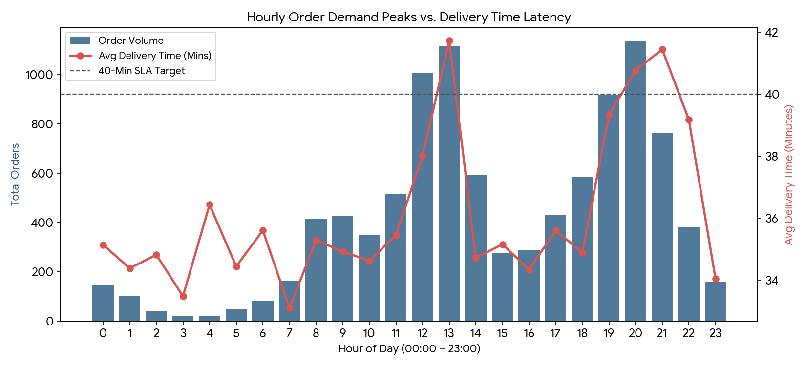
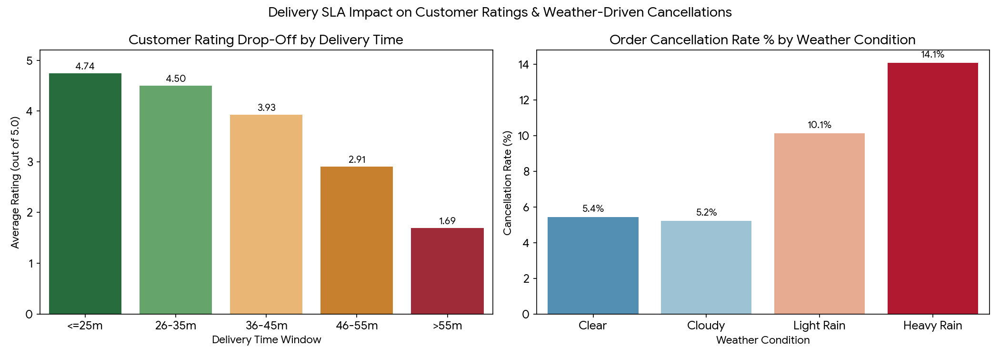

# Hyperlocal Food Delivery Operations Analysis (Python & SQL)

[]()
[]()
[]()

## Overview
An end-to-end **Operations & Logistics Analytics** project built using **SQL** and **Python** on **10,000 hyperlocal food delivery orders** across six Indian metro cities (**Bengaluru, Mumbai, Delhi NCR, Hyderabad, Pune, and Chennai**). The study investigates meal-time demand surges, delivery SLA compliance (40-minute benchmark), weather/traffic cancellation drivers, and rating sensitivity.

---

## Repository Structure
```text
food-delivery-operations-analysis/
├── data/
│   └── food_delivery_orders.csv          # 10,000 order records with timestamps, prep/transit times & ratings
├── sql/
│   └── food_delivery_analytics.sql       # SQL queries for City KPIs, Daypart Peaks, SLA Tiers & Zone Rankings
├── src/
│   └── delivery_analysis.py              # Python KPI engine & operational summary pipeline
├── images/
│   ├── hourly_order_delivery_trend.png   # Dual-axis hourly demand vs. delivery latency chart
│   └── ratings_and_cancellations.png     # Delivery SLA impact on ratings & weather cancellations
└── README.md
```

---

## Key Analytical Insights
1. **Bimodal Meal-Time Surges & Latency:** Order demand spikes sharply during **Lunch (12:00–14:00)** and **Dinner (19:00–22:00)**, pushing average delivery times past the **40-minute SLA threshold** due to kitchen prep queues and peak-hour congestion.
2. **Delivery Time vs. Customer Rating Cliff:** Orders delivered within **30 minutes** average **~4.74★**, whereas deliveries exceeding **55 minutes** plummet below **1.90★**, proving delivery speed is the primary driver of customer satisfaction.
3. **Weather & Prep Delay Cancellations:** **Heavy Rain** triples cancellation rates compared to clear weather due to rider supply shortages, while **Restaurant Prep Overflow** accounts for the largest share of operational cancellations.

---

## Visual Insights



---

## How to Run
```bash
pip install pandas numpy matplotlib seaborn
python src/delivery_analysis.py
```
To run the SQL analytics, import `data/food_delivery_orders.csv` into PostgreSQL, MySQL 8.0+, or BigQuery and execute `sql/food_delivery_analytics.sql`.
